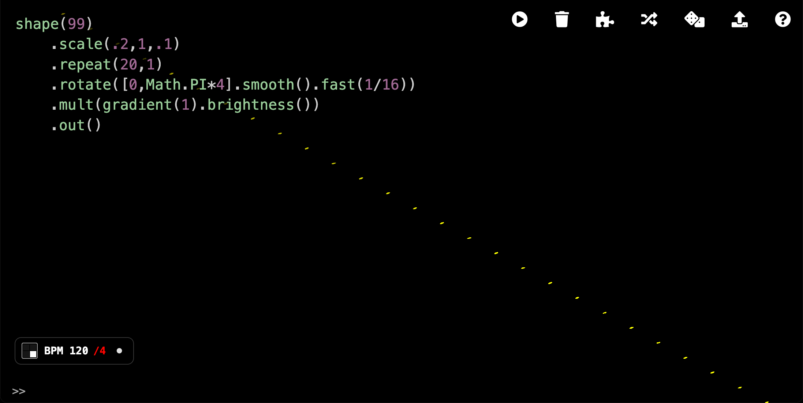

# Hydra BPM Tools

Tempo control for [Hydra](https://hydra.ojack.xyz/), closer to how BPM is handled in VJ software: tap tempo, resync, BPM nudging, a draggable HUD, and beat-synced helpers.



## Quick Start

Paste this at the top of the Hydra editor:

```js
await loadScript("https://link.beatmelab.com/hydra-bpm-tools")
```

You get:

- A draggable BPM HUD
- Tap tempo and resync controls
- BPM nudging and rate multipliers
- Hush control for blanking output and clearing persistent feedback
- Beat-synced helper functions for modulation

<!-- markdownlint-disable MD033 -->
<details>
<summary>Direct jsDelivr URL</summary>

```js
await loadScript("https://cdn.jsdelivr.net/gh/beatmelab/hydra-bpm-tools@v2.2.4/hydra-bpm-tools.lib.js")
```

</details>
<!-- markdownlint-enable MD033 -->

## Why Use It

Hydra exposes a `bpm` variable, but it does not provide dedicated on-screen controls for tapping, nudging, or resyncing tempo during a performance.

- Tap tempo when you need to match external music or video quickly
- Resync beat-driven modulation when the tempo is right but phase has drifted
- Nudge BPM live without stopping the patch
- Use the same BPM for both transport control and patch modulation

## Features

- Draggable BPM HUD that stays visible while you work
- Tap tempo for fast matching
- Resync to restart beat-driven motion from a clean point
- Keyboard shortcuts for tempo, rate, hush, and HUD visibility
- Hush toggle for blanking output while keeping timing state
- Beat-synced helpers like `beats()` and `beatsTri()`
- Rate multipliers for fast half-time and double-time changes

## Shortcuts

All shortcuts use `Ctrl+Shift` plus one additional key.

| Shortcut | Action |
| -------- | ------ |
| `Ctrl+Shift+Space` | Tap tempo |
| `Ctrl+Shift+R` | Resync |
| `Ctrl+Shift+↑/↓` | Adjust BPM |
| `Ctrl+Shift+←/→` | Halve or double the rate multiplier |
| `Ctrl+Shift+B` | Toggle `hush()` |
| `Ctrl+Shift+Enter` | Run sketch and clear hush state |
| `Ctrl+Shift+J` | Toggle HUD visibility |
| `Ctrl+Shift+K` | Toggle minimal HUD mode (number only) |

Tap at least three times to estimate the tempo. A pause longer than two seconds starts a new tap sequence. Holding the key does not add extra taps.

`Ctrl+Shift+T` remains available as a legacy tap tempo alias where the browser allows it. Browsers may intercept it to reopen closed tabs, especially on Windows; use `Ctrl+Shift+Space` as the primary shortcut on all systems.

Hush blanks Hydra's outputs without resetting BPM or time. Unhush restores output by re-evaluating the code currently in the editor, so any sketch side effects run again.

## Beat Envelopes

These helpers return values that move with the current BPM, so they can drive Hydra parameters like `scale()`, `rotate()`, or `color()` with beat-synced motion.

```js
beats(n)      // 1->0; repeats every n beats
beats_(n)     // 0->1; repeats every n beats
beatsTri(n)   // 1->0 in n beats, then 0->1 in another n (full cycle: 2n)
beatsTri_(n)  // 0->1 in n beats, then 1->0 in another n (full cycle: 2n)
```

- `.curve(q)` changes the response curve without changing BPM sync.
- `.range(min, max)` remaps the normalized output to the interval your patch needs.

Example:

```js
osc().scale(beatsTri(2).curve(2).range(1, 2))
```

## How it works internally

Under the hood, Hydra BPM Tools updates Hydra’s internal BPM value and resyncs beat-based motion by resetting Hydra’s internal time variable.

## Programmatic API

The same controls are available from code through `window.hydraBpmTools`:

```js
hydraBpmTools.setBpm(140)
hydraBpmTools.getBpm()
hydraBpmTools.getEffectiveBpm()
hydraBpmTools.setRate(2)
hydraBpmTools.getRate()
hydraBpmTools.resync()
hydraBpmTools.toggleHudVisibility()
hydraBpmTools.toggleHudMode()
await hydraBpmTools.hush()
await hydraBpmTools.unhush()
hydraBpmTools.toggleHush()
```

`getBpm()` returns the base BPM shown in the HUD. `getEffectiveBpm()` returns the rounded BPM applied to Hydra after the rate multiplier, limited to 1–999. `setBpm()` rounds and limits the base BPM to 1–999; `setRate()` snaps to the nearest supported multiplier (`1/32`, `1/16`, `1/8`, `1/4`, `1/2`, `1`, `2`, `4`, `8`, `16`, or `32`). Both setters accept finite numbers and numeric strings; other values are ignored. `hush()` and `unhush()` resolve to `true` when the requested operation succeeds and `false` otherwise.

## Extra: automatic loading of libraries

The optional [Hydra autoload libs](extras/hydra-autoload-libs.user.js) userscript can load multiple libraries when the Hydra editor opens.

1. Install a userscript manager such as [Tampermonkey](https://www.tampermonkey.net/) or [Violentmonkey](https://violentmonkey.github.io/).
2. Install the script from its [raw URL](https://raw.githubusercontent.com/beatmelab/hydra-bpm-tools/main/extras/hydra-autoload-libs.user.js). Its metadata limits it to the Hydra editor; check the manager's site access settings if needed.
3. Edit the script's `libs` array in the manager. The example loads Extra Shaders for Hydra; to load BPM Tools too, add:

```js
{ url: "https://cdn.jsdelivr.net/gh/beatmelab/hydra-bpm-tools@v2.2.4/hydra-bpm-tools.lib.js" },
```

The autoload script has automatic updates disabled to preserve your library list.

## What gets saved

HUD position, visibility, and minimal mode are saved in `localStorage` across browser sessions. BPM and rate are not persisted.

For screenshots and a more visual overview, see the [landing page](https://hydra-bpm-tools.beatmelab.com/).

## Attribution

The envelope API is adapted from [`hydra-tap` in geikha/hyper-hydra](https://github.com/geikha/hyper-hydra/blob/main/doc/hydra-tap.md).

## Author

Gonzalo Ovejero · [@alt234vj](https://www.instagram.com/alt234vj) · [@beatmelab](https://www.instagram.com/beatmelab) · [beatmelab.com](https://www.beatmelab.com)

## License

GPL-3.0
